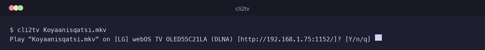
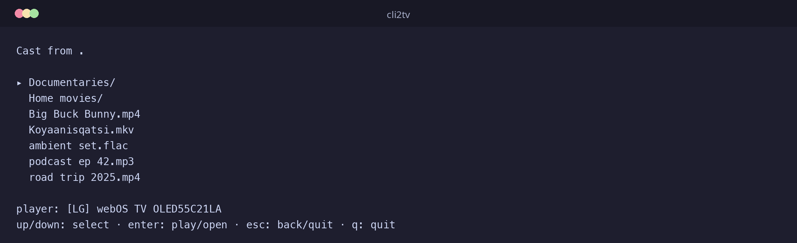

# cli2tv

Cast media files to Smart TVs and Chromecast devices, straight from your terminal.

**cli2tv** is a pure-CLI fork of [go2tv](https://github.com/alexballas/go2tv) (v2.8.0) with the Fyne GUI removed. Everything that made go2tv's command line useful is still here — DLNA/UPnP and Chromecast casting, on-the-fly transcoding, subtitles, torrents, internet radio, stdin piping, and the headless web server — with a new zero-config front door:

```console
$ cli2tv movie.mkv
Play "movie.mkv" on [LG] webOS TV OLED55C21LA (DLNA) [http://192.168.1.75:1152/]? [Y/n/q] y

Selected [LG] webOS TV OLED55C21LA (DLNA) [http://192.168.1.75:1152/]
```



```console
$ cli2tv
Cast from .

▸ Documentaries/
  Home movies/
  Big Buck Bunny.mp4
  Koyaanisqatsi.mkv
  ambient set.flac
  podcast ep 42.mp3
  road trip 2025.mp4

player: [LG] webOS TV OLED55C21LA
up/down: select · enter: play/open · esc: back/quit · q: quit
```



Give it a file and it finds the first player on your network, asks for confirmation, and plays. Answer `n` and it moves on to the next discovered player; `q` aborts. No `-t`, no `-l`, no copy-pasting device URLs.

The last confirmed player is remembered in `~/.cache/cli2tv/` and probed first on the next run — if it's still up, the confirmation appears instantly instead of waiting for discovery.

---

## What it works with

- **Smart TVs** — Samsung, LG, Sony, and others that support DLNA/UPnP
- **Chromecast** — Google Chromecast, Chromecast with Google TV, and compatible devices
- **Apps** — BubbleUPnP, GMediaRender, and other media receiver apps

## Features

- **Zero-config casting** — `cli2tv file.mkv` autodetects a player, confirms, and plays
- **Auto-discovery** — SSDP (DLNA) + mDNS (Chromecast) device discovery
- **Transcoding** — converts incompatible formats on-the-fly (requires FFmpeg), with GPU encoder probing and fallback
- **Subtitles** — external SRT/VTT/ASS/SSA files and embedded MKV subtitles, including burn-in
- **Seek support** — jump to any position in the video
- **Torrent playback** — magnet links or `.torrent` files, cast while downloading
- **Internet radio** — cast Radio Browser stations by URL
- **stdin streaming** — pipe from yt-dlp, ffmpeg, or anything else
- **Interactive playback screen** — pause, seek, stop, and volume from the terminal
- **Web server mode** — browse media roots and cast from any browser

---

## Installation

### From source

Requirements: [Go](https://go.dev/dl/) 1.26.9 or later. No C compiler or GUI toolkit needed — cli2tv is pure Go.

```console
git clone https://github.com/asnicool/cli2tv
cd cli2tv
make build    # binary lands in build/cli2tv
make install  # or: go install ./cmd/cli2tv
```

### Optional: FFmpeg for transcoding

For maximum compatibility with all devices and file formats, install [FFmpeg](https://ffmpeg.org/download.html). cli2tv uses it automatically when needed:

- **Linux**: `sudo pacman -S ffmpeg` / `sudo apt install ffmpeg`
- **macOS**: `brew install ffmpeg`
- **Windows**: `winget install Gyan.FFmpeg`

If it's not on `PATH`, point at it with `-ffmpeg /path/to/ffmpeg`.

---

## Usage

### Mode 1: cast with autodetection

Pass a media file (positionally or with `-v`) and cli2tv discovers players while asking you about each one in turn:

```console
# Local file — positional or -v
cli2tv movie.mkv
cli2tv -v movie.mkv

# Remote URL or magnet link
cli2tv -u https://example.com/movie.mp4
cli2tv -u 'magnet:?xt=urn:btih:...'

# Stream from another command
yt-dlp -o - "https://youtu.be/..." | cli2tv -
```

For each discovered player it prompts:

```console
Play "movie.mkv" on Living Room TV (DLNA) [http://192.168.1.100:8060/]? [Y/n/q]
```

- `Y` (or Enter) — play on this device
- `n` — skip it and wait for the next discovered player
- `q` — stop searching

If nothing is found within the discovery window, cli2tv exits with an error. When stdin is not a terminal (scripts, cron), the first discovered player is selected automatically without prompting.

All other flags combine normally — for example, subtitles and transcoding still apply:

```console
cli2tv movie.mkv -s movie.srt -tc
```

### Mode 2: browse and pick from a TUI

Run `cli2tv` with no argument to browse the current folder, or name a directory to browse that instead:

```console
cli2tv
cli2tv ~/Videos
cli2tv -v ~/Videos      # same thing
```

The browser lists subdirectories and castable video/audio files (hidden entries skipped). Device discovery runs in the background while you browse — the footer shows what's been found.

- `up`/`down` — move the selection
- `enter` — play a media file, or descend into a subdirectory
- `esc` — go back up one directory (quit when at the starting folder)
- `q` — quit

Pressing enter on a media file plays it right away on the single discovered player; with several players found, a chooser lets you pick one. Playback flags like `-tc` or `-s` apply to whatever you pick. Leaving the browser with `esc`/`q` without playing exits cleanly.

Piped stdin (`some-cmd | cli2tv -`) still streams directly and never opens the browser.

### Explicit device selection

Find devices with `-l` (keeps scanning; `q` to quit):

```console
$ cli2tv -l
Scanning devices... (q to quit)

• Living Room TV DLNA [http://192.168.1.100:8060/]
• Kitchen speaker Chromecast [http://192.168.1.50:8009]
```

Then pass the URL to `-t` to skip discovery and confirmation entirely:

```console
cli2tv -v movie.mp4 -t http://192.168.1.100:8060/
cli2tv -v movie.mkv -s movie.srt -tc -t http://192.168.1.100:8060/
cli2tv -u https://example.com/movie.mp4 -t http://192.168.1.50:8009
```

Chromecast URLs normally end in `:8009`; DLNA URLs vary by TV.

### Torrents

```console
# Single-media torrent
cli2tv movie.torrent -t http://192.168.1.100:8060/

# Multi-media torrent: pick the file index
cli2tv -u 'magnet:?xt=urn:btih:...' -torrent-file 0 -tc -t http://192.168.1.50:8009
```

Omit `-torrent-file` for torrents containing one media file; omitting it on a multi-media torrent lists the indexes. Seeks fetch missing pieces first. Embedded text captions render automatically; `-no-torrent-subtitles` disables that, and `-burn-subtitles` (with `-tc`) is the Chromecast compatibility fallback for external captions.

### Web server mode

Browse media folders and cast from any browser:

```console
cli2tv -server -media-root /path/to/Media
```

Defaults to `http://127.0.0.1:9666/`. Repeat `-media-root` for multiple directories. For LAN access, set a non-loopback `-listen` and allow each browser origin:

```console
cli2tv -server \
  -listen 0.0.0.0:9666 \
  -allowed-origin http://192.168.1.20:9666 \
  -media-root /path/to/Media
```

> LAN mode uses HTTP without TLS. Use it only on trusted networks.

### All flags

Run `cli2tv -h` for the authoritative list.

| Flag | Description |
|------|-------------|
| (positional) | Media file to cast, or a directory to browse |
| `-v` | Path to media or `.torrent` file (a directory opens the browser) |
| `-u` | Media URL or magnet link |
| `-t` | Device URL to cast to (from `-l` output); omit to autodetect |
| `-s` | Subtitles file (`.srt`, `.vtt`, `.ass`, `.ssa`) |
| `-tc` | Force transcoding with FFmpeg |
| `-burn-subtitles` | Burn Chromecast subtitles when transcoding (compatibility fallback) |
| `-torrent-file` | Media file index within a torrent |
| `-no-torrent-subtitles` | Disable automatic embedded torrent subtitles |
| `-l` | List available devices (Smart TVs and Chromecasts) |
| `-ffmpeg` | FFmpeg command or path for transcoding |
| `-server` | Run web server mode |
| `-listen` | Web server listen address (default `127.0.0.1:9666`) |
| `-media-root` | Allowed media directory (repeatable; required with `-server`) |
| `-allowed-origin` | Allowed web origin (repeatable; required for non-loopback `-listen`) |
| `-debug` | Web server protocol debug logs |
| `-version` | Print version |

### Troubleshooting

**Device not found**

- Computer and TV/Chromecast must be on the same network; guest Wi-Fi, separate 2.4/5 GHz SSIDs, and different subnets block discovery.
- Disconnect any VPN — it can route discovery traffic away from your LAN.
- Make sure the TV is on and its DLNA/media-sharing setting is enabled.
- `cli2tv -l` keeps scanning; give slow devices a few seconds to appear.

**Firewall**

Allow inbound traffic from your local network:

- `3339-3438/udp` — DLNA/UPnP device discovery
- `3500-4499/tcp` — local HTTP media server used during playback

---

## Roadmap

- [x] **Mode 1** — `cli2tv file.mkv`: autodetect player, confirm, cast (with a last-device cache for instant re-runs)
- [x] **Mode 2** — bare `cli2tv` (or a directory argument): TUI media browser with player discovery in the background

---

## Credits

cli2tv is a fork of [go2tv](https://github.com/alexballas/go2tv) by Alexandros Ballas — all credit for the casting core (DLNA/UPnP, Chromecast protocol, transcoding pipeline) goes to the original project. The GUI was stripped and the CLI-first workflow added in this fork.

This fork was vibe-coded with [Claude Code](https://claude.com/claude-code) (Anthropic) and [GLM](https://z.ai) — planning, test-driven implementation, and docs.

## License

MIT — inherited from go2tv.
